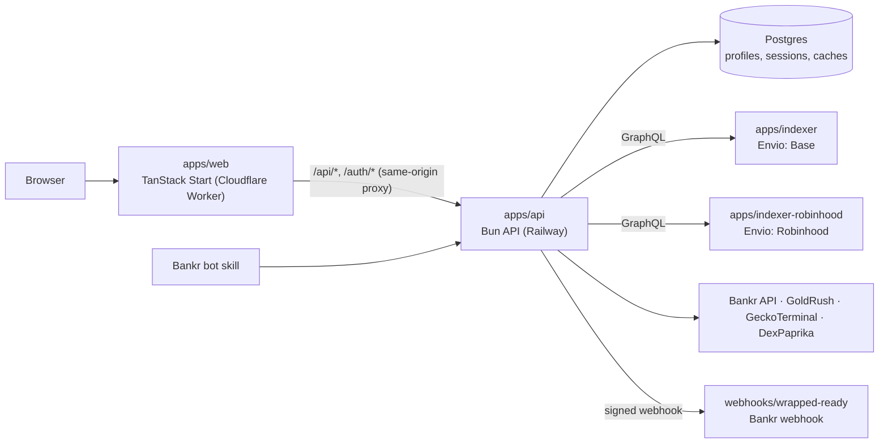

# Bankr Wrapped

A Spotify-Wrapped-style yearly recap for [Bankr](https://bankr.bot) token launchers: tokens launched, Please Bro tokens, ETH earned from fees, best day, longest streak and lifetime trading volume.

Earnings and volume come from purpose-built on-chain indexers for Base and Robinhood Chain, cross-checked against Bankr's own API. Bankr's API also defines which launches count as Bankr launches.

**Site:** [bankrwrapped.com](https://bankrwrapped.com) (pre-launch: sign-in is gated behind `/soon`).

## Architecture



- The **frontend worker proxies `/api/*` and `/auth/*`** to the API, so the session cookie is first-party on bankrwrapped.com. Every browser accepts it, Safari and iOS included.
- **The API never touches the indexers' databases.** It reads them only through their GraphQL endpoints.
- **Trading volume never blocks a request.** The first visit returns `pending`. A background job computes the real number, a later request picks it up, and a webhook can notify the user when it's ready.

## Repository layout

| Path | What it is |
| --- | --- |
| [`apps/api`](./apps/api) | Bun HTTP API: X OAuth, Wrapped payloads, leaderboard, earnings and volume computation, background sweeps |
| [`apps/web`](./apps/web) | React 19 + TanStack Start frontend, plus the same-origin API proxy |
| [`apps/indexer`](./apps/indexer) | Envio HyperIndex indexer for Base: Doppler + Clanker launches, swaps, fee events |
| [`apps/indexer-robinhood`](./apps/indexer-robinhood) | Envio indexer for Robinhood Chain (Doppler only). Currently paused |
| [`packages/shared`](./packages/shared) | TypeScript types shared by the API and the frontend (`WrappedPayload`, ...) |
| [`webhooks/wrapped-ready`](./webhooks/wrapped-ready) | Bankr webhook that posts "your Wrapped is ready" |
| [`skills/bankr-wrapped`](./skills/bankr-wrapped) | Bankr bot skill definition |
| [`KNOWN_ISSUES.md`](./KNOWN_ISSUES.md) | Open issues, recent fixes, deploy checklist and roadmap |

## Getting started

Requires [Bun](https://bun.sh) 1.3+.

```bash
bun install
bun run dev        # all apps via Turborepo
```

Each app's README covers its environment variables and how to run it on its own.

## Quality checks

```bash
bun run typecheck  # api + web; `build` depends on this, so deploys fail on type errors
bun run test       # all test suites (api, web, both indexers, webhook)
```

API tests never load `apps/api/.env`. Database tests are opt-in: set `TEST_DATABASE_URL` to a throwaway Postgres server. They create and drop their own databases, so never point it at production.

```bash
TEST_DATABASE_URL=postgresql://user@localhost:5432/postgres bun run test
```

## Deployment

| Component | Where | Build / start |
| --- | --- | --- |
| API | Railway (`railway.api.json`, `Dockerfile`, `nixpacks.toml`) | `bunx turbo run build --filter=@bankr-wrapped/api` → `bun run apps/api/dist/index.js` |
| Frontend | Cloudflare (Lovable / Nitro build) | `vite build` |
| Indexers | Railway (`apps/*/railway.json`) | `envio codegen` → `envio start` |

Database schema: `psql "$DATABASE_URL" -f apps/api/db/schema.sql`. It's idempotent, so run it on every deploy that changes it. Check the pending deploy steps in [`KNOWN_ISSUES.md`](./KNOWN_ISSUES.md) before shipping.
